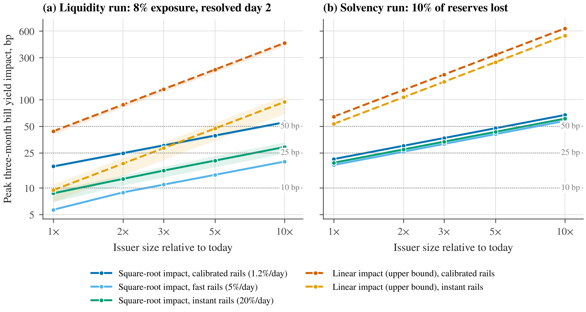

<p align="center"></p>

<h1 align="center">stablerun</h1>

<p align="center"><b>When Stablecoins Run: Fire-Sale Spillovers to the Treasury Bill Market</b><br>
Thanatchon Chongmankhong · Working paper, November 2026</p>


[](https://thanatchon36.github.io/stablerun/paper/)
[](https://github.com/thanatchon36/stablerun/raw/main/paper.pdf)
[](LICENSE)
[](https://doi.org/10.5281/zenodo.23996044)
[](https://huggingface.co/datasets/thanatchon36/stablerun)

📖 **[Read the paper online](https://thanatchon36.github.io/stablerun/paper/)** ·
⬇️ **[Download the PDF](https://github.com/thanatchon36/stablerun/raw/main/paper.pdf)** ·
📝 **[Research proposal](docs/proposal.md)** ·
⚙️ **[Parameters](config/params_default.yaml)** ·
🤗 **[Simulation data](https://huggingface.co/datasets/thanatchon36/stablerun)** ·
🔍 **[References to verify](docs/references_to_verify.md)**

**An agent-based stress test of stablecoin runs and their fire-sale spillovers to the US Treasury-bill market.**
Payment stablecoins are large holders of Treasury bills. stablerun is a calibrated agent-based model of a stablecoin
run: heterogeneous holders, a secondary market with capital-constrained arbitrage, an issuer with a redemption queue
and a liquidation waterfall, and a bill market with permanent and temporary price impact. The accompanying working
paper uses it to measure how a run reaches the bill market.

- **Spillover and channel:** at today's size, a run on the largest issuer moves three-month bill yields by roughly
  20 bp and sells almost no bills outright. Redemptions are throttled by processing capacity and funded by maturing
  bills, so the externality is demand withdrawn at auction rather than a fire sale, and the issuer's own fire-sale
  losses are negligible.
- **Systemic size:** under square-root price impact the 25 bp mark is crossed at 1.4–2× today's size and the
  50 bp mark at 5.5–8×. Under linear impact (the upper bound) both are crossed today.
- **Policy levers:** a 20–30% cash buffer removes the bill-market footprint of a liquidity run and cuts that of a
  solvency run by two thirds. Maturity caps convert outright sales into non-rollover. Redemption fees do little.
  Redeeming at net asset value rather than par cuts the depeg by a third.

<p align="center"></p>

## Install and quickstart

```bash
pip install -r requirements.txt                   # Python >= 3.10
python -m pytest -q                               # 21 unit and end-to-end tests
python scripts/run_all.py --experiment E1         # baseline run on Issuer A (add --issuer B for Issuer B)
python scripts/run_all.py --experiment all        # every experiment, figure and LaTeX table (~25 min on one CPU)
```

Every run is determined by `config/params_default.yaml`, the overrides passed, and the seed (`meta.seed`).

| `--experiment` | Purpose |
|---|---|
| `E1` | Baseline run dynamics for Issuer A or B (`--issuer A\|B`) |
| `E2` | Tipping point: peak bill-yield impact against issuer size |
| `E3` | Policy grid: cash buffer, redemption fee, maturity cap, Fed backstop, NAV redemption |
| `E4` | Contagion: a run on Issuer A spills over to Issuer B's beliefs through A's depeg |
| `E5` | Sensitivity analysis (tornado) |
| `benchmark` | Closed-form threshold benchmark that the simulation must reproduce |
| `validate` | Re-run the two calibration episodes with the current parameters: validation table and Figure F4 |
| `calibrate` | Re-fit the behavioural parameters and patch `config/params_default.yaml` in place |
| `figures`, `tables` | Figures F1–F6 and the LaTeX tables from saved results |
| `all` | Everything above except `calibrate` |

Other flags: `--paths` (Monte Carlo paths), `--seed`, `--impact sqrt|linear`, `--config`, `--out`.

## Research: *When Stablecoins Run* (2026)

The paper is [`paper.pdf`](paper.pdf) (23 pages, November 2026 draft), with LaTeX source in [`paper/`](paper/) and a
[web version](https://thanatchon36.github.io/stablerun/paper/) with the same text and numbers.
It answers three questions: how large the Treasury-market spillover of a run is and through which channel, at what
sector size it becomes systemic, and which policy levers work. The model is calibrated to the USDC episode of
March 2023 and the USDT episode of May 2022, and it nests a closed-form threshold benchmark that the simulation
reproduces exactly. Every table in the paper is generated by `scripts/make_tables.py` from `results/tables`.

- Figures and tables for every experiment: [`results/`](results/) (PDF and PNG figures, Markdown and CSV tables)
- Simulation outputs, including all 10,000 E1 Monte Carlo paths: Hugging Face dataset
  [`thanatchon36/stablerun`](https://huggingface.co/datasets/thanatchon36/stablerun), built by `scripts/make_hf_dataset.py`
- Archived release: [doi:10.5281/zenodo.23996044](https://doi.org/10.5281/zenodo.23996044) (Zenodo)
- Parameters, each with a source and a confidence annotation: [`config/params_default.yaml`](config/params_default.yaml)
- Research proposal and phase notes: [`docs/`](docs/)

Reproduce:

```bash
bash scripts/fetch_fonts.sh                       # optional: TeX Gyre Pagella for the figures (the paper's Palatino)
python scripts/run_all.py --experiment all        # E1 (A and B), E2–E5, benchmark, validate, figures, tables
python scripts/run_all.py --experiment calibrate  # optional: re-fit the behavioural parameters
cd paper && latexmk -pdf main.tex                 # rebuild the paper (or: tectonic main.tex)
bash paper/make_arxiv.sh                          # arXiv bundle paper/arxiv.tar.gz (needs tectonic)
python scripts/build_web_paper.py                 # web reader docs/paper/ from the LaTeX source (needs pandoc)
```

Figures follow one house style (`src/stablerun/style.py`): Pagella text to match the paper, the Okabe–Ito
colour-blind-safe palette, direct labels instead of legends where lines can be labelled at their ends, and PDFs
written without timestamps so that a rebuild is reproducible byte for byte. Without the fonts the figures fall
back to STIX.

The arXiv bundle holds `main.tex` (with `\pdfoutput=1` so arXiv uses pdfLaTeX), the section files, the
precompiled `main.bbl` (arXiv does not run BibTeX) and only the tables and PDF figures the paper uses. The script
compiles the bundle without `refs.bib` and fails if any citation or reference is undefined.

## Repository layout

```
paper.pdf                    the working paper
config/params_default.yaml   all parameters with source and confidence annotations (values marked VERIFY must be checked)
src/stablerun/
  config.py       YAML loading, overrides, policy hooks (cash buffer, fee, maturity cap, Fed backstop, NAV redemption)
  agents.py       holder population, threshold exit rule, re-entry rule
  market.py       secondary market: fundamental and liquidity discount, overhang, arbitrage capacity
  issuer.py       reserves, impairment, bill-ladder run-off, liquidation waterfall, mark-to-market
  billmarket.py   bill price impact (persistent and temporary), dealer inventory and capacity penalty
  simulate.py     vectorised daily simulation over Monte Carlo paths
  metrics.py      per-path metrics and summaries
  calibrate.py    two-stage calibration to the USDC-2023 and USDT-2022 episodes
  experiments.py  E1 baseline;  experiments2.py  E2 tipping point, E3 policy grid, E4 contagion, E5 sensitivity, benchmark
  plots.py, plots2.py, style.py   figures F1-F6 in a common house style
scripts/          run_all.py (CLI), make_tables.py (LaTeX tables), make_hf_dataset.py (Hugging Face data), fetch_fonts.sh, run_phase3.py
tests/            pytest suite
results/          figures (PDF and PNG) and tables (Markdown and CSV) for every experiment
paper/            LaTeX source, bibliography, figures and tables; make_arxiv.sh builds the arXiv bundle
docs/             web reader (docs/paper/, served by GitHub Pages), proposal, phase notes, references to verify, LinkedIn post, card and poster (scripts/make_linkedin_card.py, make_linkedin_poster.py), logo
```

## Honesty and limitations

Issuer sizes and reserve mixes are defaults from public attestations as remembered when the model was built, and
every reference was compiled without database access: see
[`docs/references_to_verify.md`](docs/references_to_verify.md) and the `VERIFY` tags in the config. The model fits
redemption volumes well and price troughs less well. It has no inflows, no hourly dynamics and no bank-deposit
channel, and it extrapolates price impact from small normal-times flows. It is a stress-testing tool, not a forecast.

## Related projects
- [stablecoin-tbills-genius-act](https://github.com/thanatchon36/stablecoin-tbills-genius-act): the empirical
  companion. It asks whether stablecoin flows move T-bill yields differently after the GENIUS Act, using open data
  and local projections.

## Citation
See [`CITATION.cff`](CITATION.cff). License: MIT.

```bibtex
@unpublished{chongmankhong2026stablerun,
  author = {Chongmankhong, Thanatchon},
  title  = {When Stablecoins Run: Fire-Sale Spillovers to the Treasury Bill Market. An Agent-Based Stress Test},
  note   = {Working paper and code repository},
  year   = {2026},
  doi    = {10.5281/zenodo.23996044}
}
```
